<div align="center">



<br>

[](../../releases/latest)


[](LICENSE)

**Spin the roulette, accept the contract, and the game takes you straight to the mission — loadout locked, objectives written into the contract, failure enforced by the game itself.**

</div>

> [!NOTE]
> **Public beta.** Roulette 47 works and is played daily, but it has only been tested on a few machines so far. If
> something looks wrong, please [open an issue](../../issues) and attach `Retail\Roulette47\diagnostic.log` — see
> [Reporting a problem](#reporting-a-problem).

---

## What is Roulette 47?

**Roulette 47** is a standalone mod for **HITMAN: World of Assassination** that turns every session into a
randomised contract — the way the community has played *Hitman roulette* for years, but **inside the game**:

- 🎯 **One spin, everything drawn** — destination, mission, **one to three targets** (the mission's own targets
  *and* regular NPCs of the level, on an equal footing), a kill method and an outfit for each target,
  complications, starting location, concealed weapon and gear.
- ✅ **Accept, reroll or decline.** Accept and the mission's **planning screen opens immediately** — no menu
  navigation, no simulated key presses — with the **loadout locked**: only the suit is left to choose, then *Play*.
- 🧾 **Written into the real contract.** The roulette objectives replace the mission's objectives; the game tracks
  them like its own, shows them on the briefing and the loading screen, and **fails the mission the vanilla way**
  at the first deviation.
- 🔗 **Share a contract** — every contract has a code: send it to a friend, they paste it and get the very same
  contract. Nothing is stored anywhere, the code *is* the contract.
- 🎚️ **Always Professional.** Every roulette contract is played on Professional difficulty, locked on the planning
  screen.
- 🌐 **Played online**, on the official servers. No Peacock, no Simple Mod Framework, no game file modified.
- 🗣️ **In your language** — French, English, Italian, Spanish and Russian, detected from the game itself.

<div align="center">

</div>

## The three modes

| Mode | Outfit | Loadout | Kill methods | Complications |
|---|---|---|---|---|
| **Assassin** *(default)* | Agent 47's suit, from a suited start | Silenced Silverballer (variant drawn from the ones you own), fiber wire, your best lockpick | Pistol, fiber wire, accident, poison found on site | Realistic only: unseen, no bodies, no collateral, no cameras, no disguise change, headshots when a pistol is required, kill order |
| **Purist** | Suit only | No gun — fiber wire and coins | Precise accidents (drowning, fall, electrocution, falling object, burn, explosion), poison or fiber wire | Always the five Silent Assassin, Suit Only requirements |
| **Freestyle** | Anything | Anything you own | Every method family you enable | Drawn at random, 0 to 3 |

All modes draw **three targets at most** and **one to three complications** (Purist: always its five), every
contract is played on **Professional** difficulty, and there is **no safety net**: saving is disabled for the whole
mission, like an elusive target — one attempt per contract.

- **Kill order enforced** — a complication (Assassin, Freestyle): the targets must die in the order shown on the
  sheet; killing one out of turn fails the contract.
- **Purist streak** — the Purist card keeps your **streak** of contracts completed in a row; a failure or an abandon
  sets it back to zero.
- **Fair starts** — if the drawn starting location puts 47 in plain sight, *Don't get spotted* is dropped instead
  of failing you in the first seconds, and is never drawn again with that starting location.
- **Freestyle disguises** — when a target must be killed in a given disguise and one of your starting locations
  puts 47 in it, the roulette starts you there.
- **Your suit, your choice** — the starting suit is purely cosmetic, so it stays free: the game's own planning
  screen remains open, with the drawn weapon, items and starting location preselected and nothing else offered in
  their lists, while the suit slot lists every suit you own (the classic black suit is preselected). Offered when
  the starting location puts 47 in a suit; a starting location in a disguise locks the whole screen as before.
- **Estimated difficulty** — every contract shows a rating from 1 to 10 and what weighs most in it (see below).

## How a contract plays

```
   F9 ─► choose a mode ─► DRAW A CONTRACT ─► the roulette spins
                                              │
               ┌──────────────────────────────┼──────────────────────┐
           Decline                         Reroll                  Accept   (or Copy code to share it)
        (nothing changes)            (spin once more)                │
                                                                     ▼
                    (loading screen) planning screen opens, loadout locked, suit free ─► Play
                                                                     │
                                    objectives tracked live on the sheet (F9)
                                    the first deviation fails the mission in-game
```

## Installation

1. Download **`roulette47-vX.Y.zip`** from the [latest release](../../releases/latest).
2. Close the game, then extract the archive into the game folder
   (`…\steamapps\common\HITMAN 3`), so that you get:

   ```
   HITMAN 3\Retail\version.dll               the loader (the game loads it by itself)
   HITMAN 3\Retail\Roulette47\Roulette47.dll the mod
   HITMAN 3\Retail\Roulette47\ui\            its interface
   ```

3. Start the game and press **F9** in the menus.

> **Requirements:** Windows 10/11 x64 and the Microsoft Edge WebView2 Runtime, which ships with Windows 11 and comes with
> Edge on Windows 10. If it is missing, Roulette 47 offers to download and install it (official Microsoft installer)
> the first time the game starts.
>
> No modding framework is required, and Roulette 47 lives side by side with other mods.
>
> **Steam only.** The Epic Games Store and Xbox / Game Pass versions are not supported.

> [!IMPORTANT]
> **Antivirus warnings.** `version.dll` is an unsigned loader that the game picks up by itself and that hooks into the
> game's code in memory — exactly the pattern some antivirus heuristics flag, so a false positive is possible. Only
> download Roulette 47 from this repository's [releases](../../releases); the code is public, and every release
> lists the SHA-256 of its archive so you can check what you got.

**Uninstall:** delete `Retail\version.dll` and the `Retail\Roulette47` folder.

## Using it

| | |
|---|---|
| **F9** | Open or close the contract sheet (mouse and keyboard go to the sheet while it is open; the game keeps running and its music keeps playing, but the mouse no longer turns the camera). |
| **Esc** | Close the sheet. |
| In mission | The sheet shows each target, its method and outfit, the complications and the loadout, updated live. |

The first time you play a level, the mod records the NPCs present in it; from then on they can be drawn as targets
for that mission, alongside the mission's own targets.

### Estimated difficulty

The rating is computed from the drawn contract with fixed weights — it is an estimate, not a measurement. Each
target costs a point (a little more for an NPC, which the mission does not stage), plus its method (a precise
electrocution costs far more than a pistol; half as much when the locked loadout provides it, more on an NPC for
accidents that depend on the scene), plus its outfit, plus each complication (weighted by the number of targets it
affects: *Don't get spotted* with three targets costs more than with one). The total is mapped to 1–10 on a curve
that rises fast then saturates: one free target is a 1, a Purist contract with three precise accidents is a 9.
Labels: Easy (1–2), Fair (3–4), Demanding (5–6), Hard (7–8), Extreme (9–10).

### Sharing a contract

A drawn contract shows a **Copy code** button. The code (`R47-…`) holds the whole contract — mission, targets,
methods, outfits, complications, starting location and loadout. Paste it in the field under **Draw a contract**
and press **Load**: you get the same contract, ready to accept. The starting location and items are taken from
*your* unlocks; anything you have not unlocked is left free, and the sheet says so.

### Settings on the sheet

The **Settings** panel applies to every mode, within the limits of the chosen mode. Besides the number of targets
and the maximum number of complications, it lets you:

- untick **destinations** you do not want to be drawn (all ticked by default);
- draw **mission targets only** — no NPCs (off by default: mission targets and NPCs are mixed);
- restrict the **method families**, and choose whether a method and an outfit are imposed;
- show the roulette on **Discord** (on by default);
- tune the locked loadout, sounds and the automatic menus.

### Discord

While you play a Roulette 47 contract, your Discord profile shows it — mode, location, targets left — and the
presence disappears as soon as you leave the mission. The text follows the mod's language. Discord must be running
on the same PC. If another mod also writes the game's presence (such as ZHMModSDK's *DiscordRichPresence*),
Roulette 47 takes over while a contract is played and hands it back afterwards.

### Settings — `Retail\Roulette47\roulette47.ini`

Most settings live on the sheet (**Settings**). A few are only in the file:

| Key | Values | |
|---|---|---|
| `mode` | `0` Assassin · `1` Purist · `2` Freestyle | Also set on the sheet's home screen. |
| `langue` | `fr` · `en` · `it` · `es` · `ru` | Forces the interface language (default: the game's language). |
| `touche` | Windows virtual-key code | Key that opens the sheet (`120` = F9). |
| `cibles_min`, `cibles_max` | `1`–`3` | Number of targets. |
| `complications` | `0`–`3` | Most complications drawn — the number is drawn between 1 and this (Assassin and Freestyle; `0`: none). |
| `discord` | `0` · `1` | Discord Rich Presence. |
| `cibles_du_jeu` | `0` · `1` | Mission targets only, no NPCs. |
| `destinations_exclues` | comma-separated location ids | Destinations unticked on the sheet. |
| `serie_puriste` | number | Current Purist streak. |
| `outils_developpement` | `0` · `1` | Opens the WebView2 developer tools. |
| `releve` | `0` · `1` | Development only: saves the server's menu pages and contracts in `reponses\` (never login tokens, never your profile). Off by default. |
| `journal_evenements` | `0` · `1` | Development only: logs game events in `evenements.log`. Off by default. |

### What the mod keeps on your PC

Everything stays in `Retail\Roulette47\`; nothing is sent anywhere except the game's own requests to IOI's servers
and image downloads from IOI's image service.

| File | Contents |
|---|---|
| `roulette47.ini` | Your settings and Purist streak. |
| `destinations.json`, `lieux\`, `noms.json` | Locations, missions, NPCs and item names learned from the game. |
| `cache\` | Images downloaded from the game's image service. |
| `webview\` | The overlay's browser data. |
| `diagnostic.log` | What the mod did during the last session — no account name, Steam ID or token (only the game's install path). Rewritten at every start. |

From v0.20 on, the development logs (`reponses\`, `evenements.log`) are off and the files left by earlier versions
are deleted at start-up. Up to v0.19, `reponses\` could hold a copy of your game profile (Steam ID, gamertag):
do not share that folder from an older version.

### Reporting a problem

Open an [issue](../../issues) with what you did, what you expected and what happened, and attach
`Retail\Roulette47\diagnostic.log` from the session where it went wrong (it is rewritten at every start). A
screenshot of the sheet helps too.

## Under the hood

<details>
<summary><b>How the mod works</b> (click to expand)</summary>

<br>

- **Loader.** `version.dll` is a proxy for the system DLL of the same name: the game loads it at start-up, it
  forwards every call to the real one and loads `Roulette47\Roulette47.dll`.
- **Engine access without any framework.** The functions the mod needs (event dispatch, text lookup, HTTP results,
  menu actions, page navigation…) are located by byte signatures at start-up, and the engine data it reads is
  described in its own read-only views (`src/Glacier.h`). Hooks are written into the padding between the game's
  functions or into an allocated trampoline; nothing on disk is modified.
- **Server responses rewritten in memory.** Menu pages and contracts arrive as JSON from IOI's servers. The mod
  reads destinations, missions, inventory and unlocked starting locations from them, and rewrites the contract it
  receives: the roulette objectives are added as state machines (`Kill` with `KillMethodStrict`/`Broad` and outfit
  conditions, failure on the first wrong kill), the original objectives are hidden, and `Entrances` keeps the drawn
  starting location. The loadout is locked by trimming each slot's item list to the drawn item (the suit list is
  left whole); for a start in a disguise, `MandatoryLoadout` removes the planning screen like the game's own special
  missions. A `MandatoryLoadout` is not used otherwise: it replaces the whole loadout, suit included.
- **Opening the planning screen.** Menu actions are objects (`ZLink@JSONTemplate`…). The mod captures the menu
  navigator from the first link the game executes, then builds the same page request the game builds for a mission
  tile (`planning` + `contractid`) with the game's own JSON reader, on the game thread.
- **Starting location.** Choosing an entrance only writes three globals that the contract start reads back; the mod
  writes the drawn entrance there, so the game starts where the roulette decided.
- **NPC targets everywhere.** The named NPCs and disguises of a location are recorded whenever you play it; the mod
  also ships a recording of every story location (`lieux_initiaux`), so even a mission you have never played can
  draw NPC targets.
- **Names in your language.** Item and location names come from the game's own localisation (two text keys per
  item), learned whenever the game has them loaded and kept in `noms.json`.
- **Interface.** A WebView2 overlay (HTML/CSS/JS, `ui/`) above the game window; game images are downloaded from
  the game's own image service at run time and cached locally. No game asset ships with the mod.

</details>

## Building from source

Requirements: **Visual Studio 2022 Build Tools** (MSVC, C++23), **CMake ≥ 3.15**, **Ninja**, PowerShell.

```powershell
# 1. The WebView2 SDK, into sdk\ (everything else is fetched by CMake)
powershell -File tools\recuperer_webview2.ps1

# 2. Build (Release) …
tools\compiler.cmd

# … or build and install into the game folder (game closed)
tools\compiler.cmd --installer
```

The game path defaults to the Steam location; override it with `-DGAME_INSTALL_PATH=…` when configuring CMake.
`build\EssaiMenus.exe`, `EssaiContrat.exe` and `EssaiMissions.exe` run the roulette against recorded menu pages and
contracts, outside the game.

Releases are published with `python tools/publish.py` (version in `VERSION`); the three most recent releases are
kept, older ones are deleted with their tags.

## Compatibility

- Built and tested on the **Steam** version of HITMAN: World of Assassination, online.
- A game update can move the code the mod looks for: the mod then stays inactive and says so in
  `Retail\Roulette47\diagnostic.log` rather than risking a crash.
- Elusive targets are never touched.

## Credits

- [nlohmann/json](https://github.com/nlohmann/json), [miniz](https://github.com/richgel999/miniz),
  the `hde64` disassembler from [MinHook](https://github.com/TsudaKageyu/minhook) and the Microsoft WebView2 SDK —
  see [THIRD-PARTY-NOTICES.md](THIRD-PARTY-NOTICES.md).

## License

Roulette 47 is **source-available, not open source** — see [LICENSE](LICENSE). You may read the code, play with the
official releases, build it for yourself and propose improvements through pull requests. You may not redistribute
it, re-upload it, publish modified versions or reuse its code elsewhere without permission. Contributions are
welcome: by opening a pull request you agree to the contribution terms in section 3 of the license.

## Disclaimer

Roulette 47 is an unofficial fan project, not affiliated with or endorsed by IO Interactive. HITMAN and Agent 47 are
trademarks of IO Interactive A/S. The mod ships no game assets: names and images are read from the game and its
servers on your machine. Use it at your own risk.

<div align="center">
<br>
<sub>Made with a fiber wire and a lot of patience.</sub>
</div>
